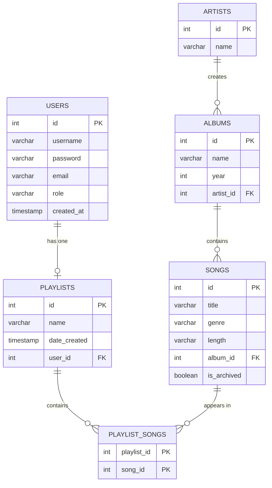

# RecordingStudioConsoleApp

A Java console application for managing a recording studio's catalog of **artists, albums, songs, users, and playlists**. Built with **JDBC, MySQL (`recording_studio_db`), and jBCrypt** using a clean **3-tier architecture** with Role-Based Access Control (`ADMIN` / `USER`).

---

## Table of Contents

- [Features](#features)
- [Tech Stack](#tech-stack)
- [Architecture](#architecture)
- [Project Structure](#project-structure)
- [Database Design](#database-design)
- [Use Cases](#use-cases)
- [Getting Started](#getting-started)
- [Running the App](#running-the-app)
- [Sample Usage](#sample-usage)
- [Design Decisions](#design-decisions)
- [Learning Path (3-Day Plan)](#learning-path-3-day-plan)
- [Troubleshooting](#troubleshooting)
- [Author](#author)
- [Acknowledgements](#acknowledgements)

---

## Features

- **Full CRUD** for Artists, Albums, Songs, Users, and Playlists
- **One playlist per user** (`PlaylistView` & `PlaylistServiceImpl` enforce one active playlist per user)
- **Soft delete (archive / restore)** across **Songs, Artists, Albums, and Users** (`is_archived`), plus permanent deletion with foreign-key protection
- **Keyword search** across Songs (by title), Artists (by name), Albums (by name), and Users (by username)
- **Login and self-registration** with **jBCrypt** password hashing (`BCrypt.hashpw` / `BCrypt.checkpw`)
- **Role-based access control (`ADMIN` & `USER`)**:
  - `USER`: browse active artists/albums/songs, search songs, create/view/delete their playlist, and add/remove songs in their playlist
  - `ADMIN`: manage Songs, Artists, Albums, and Users (View Active, Create, Update, Search, Archive, Restore, Delete)
- **Many-to-many playlist songs**: manage tracks inside a user's playlist via `playlist_songs`
- **Console UX & Validation**:
  - Interactive `Scanner(System.in)` menus with formatted ASCII tables
  - Service-layer input validation (blank fields, email format, min 6-char password, valid year `1900–2100`, positive IDs)
  - Optional keep-current-name flow when updating artists (`Enter` to keep current name)
- **SQL injection safe**: every database query uses `PreparedStatement` with try-with-resources

---

## Tech Stack

| Area | Technology |
|---|---|
| Language | Java 17 |
| Database | MySQL 8.x (`recording_studio_db`) |
| Data access | JDBC (`mysql-connector-j` 8.4.0, `PreparedStatement`, try-with-resources) |
| Build tool | Maven (`exec-maven-plugin` 3.5.0) |
| Password hashing | jBCrypt (`org.mindrot:jbcrypt` 0.4) |
| IDE (recommended) | IntelliJ IDEA |

---

## Architecture

The app follows a **3-tier architecture** with a strict one-way flow:

```
┌──────────────────────┐
│  Presentation Tier   │   Views: Scanner input, System.out output
└──────────┬───────────┘
           │ calls
┌──────────▼───────────┐
│     Service Tier     │   Business logic and validation
└──────────┬───────────┘
           │ calls
┌──────────▼───────────┐
│  Data Access Tier    │   Repositories: JDBC and SQL only
└──────────┬───────────┘
           │
        ┌──▼──┐
        │MySQL│
        └─────┘
```

| Tier | Responsibility | Must **not** |
|---|---|---|
| **Presentation** | Show menus, read input, display results and messages | Contain SQL or business rules |
| **Service** | Validate data, enforce rules, coordinate repositories | Read input or print UI messages |
| **Repository** | Run SQL through JDBC, map rows to objects | Print messages or validate business rules |

The **model** package (plain Java objects) and **config** package (database connection) are shared by all tiers.

**Key principles applied:** Separation of Concerns, DRY, composition over inheritance (constructor injection), and programming to interfaces.

---

## Project Structure

```
RecordingStudioConsoleApp
├── pom.xml
├── database
│   └── schema.sql
└── src/main/java/com/joysistvi/recordingapp
    ├── App.java                      # Entry point: wires the tiers together
    ├── config
    │   └── DbConnection.java         # Database connection settings
    ├── model
    │   ├── Artist.java
    │   ├── Album.java
    │   ├── Song.java
    │   ├── Playlist.java
    │   └── User.java
    ├── presentation                  # Tier 1
    │   ├── ArtistView.java
    │   ├── AlbumView.java
    │   ├── SongView.java
    │   ├── PlaylistView.java
    │   └── UserView.java
    ├── service                       # Tier 2
    │   ├── ArtistService.java        (interface)
    │   ├── ArtistServiceImpl.java
    │   └── ...                       (same pattern for each entity)
    └── repository                    # Tier 3
        ├── ArtistRepository.java     (interface)
        ├── ArtistRepositoryImpl.java
        └── ...                       (same pattern for each entity)
```

---

## Database Design

**Database name:** `recording_studio`

### Entity relationships

- An **Artist** creates many **Albums**
- An **Album** contains many **Songs**
- A **User** has one **Playlist** (1:1)
- A **Playlist** contains many **Songs** (many-to-many through `playlist_songs`)



### Tables

| Table | Columns |
|---|---|
| `artists` | `id`, `name` |
| `albums` | `id`, `name`, `year`, `artist_id` (FK) |
| `songs` | `id`, `title`, `genre`, `length` (text, e.g. `3:45`), `album_id` (FK), `is_archived` (default `FALSE`) |
| `users` | `id`, `username` (unique), `password` (BCrypt hash), `email` (unique), `role` (`USER` or `ADMIN`, default `USER`), `created_at` |
| `playlists` | `id`, `name`, `date_created`, `user_id` (FK, **UNIQUE**, which enforces the 1:1 relationship with `users`) |
| `playlist_songs` | `playlist_id` (FK), `song_id` (FK), composite primary key, `ON DELETE CASCADE` |

---

## Use Cases

**Both actors:** Login

**User:**
- Register Account
- Browse Artists, Albums, and Songs
- Search Songs
- Manage Own Playlist (View, Create, Delete)
- Add / Remove Songs in Playlist

**Admin:**
- Song Management (View Active, Create, Update, Search, Archive, Restore, Delete)
- Artist Management (View Active, Create, Update, Search, Archive, Restore, Delete)
- Album Management (View Active, Create, Update, Search, Archive, Restore, Delete)
- Users Management (View Active, Create, Update, Search, Archive, Restore, Delete)

> Self-registration always creates an account with role `USER`. Admin accounts can be promoted directly in MySQL or seeded via SQL.

---

## Getting Started

### Prerequisites

- **JDK 17** or newer
- **MySQL 8.x** running locally
- **Maven 3.8+** (or use the one bundled with IntelliJ IDEA)
- Git

### 1. Create and seed the database

Run `sql/schema.sql` and `sql/seed.sql` in MySQL Workbench or the MySQL CLI:

```bash
mysql -u root -p < sql/schema.sql
mysql -u root -p < sql/seed.sql
```

This creates `recording_studio_db`, all 6 InnoDB tables with 5 foreign-key constraints, and the sample users, artists, albums, songs, and playlists.

### 2. Configure the connection

Check `src/main/java/com/joysistvi/recordingapp/config/DbConnection.java` and update credentials if your local MySQL setup differs:

```java
private final static String URL = "jdbc:mysql://localhost:3306/recording_studio_db";
private final static String USERNAME = "root";
private final static String PASSWORD = "";
```

> Never commit real passwords to GitHub. Keep your local credentials out of version control or load them from environment variables.

### 3. Seeded accounts (BCrypt-hashed)

| Role | Username | Password |
|---|---|---|
| `ADMIN` | `admin` | `admin123` |
| `USER` | `user` | `user123` |
| `USER` | `james` | `james123` |
| `USER` | `anj` | `anj123` |
| `USER` | `new` | `new123` |

To promote another user to `ADMIN` in MySQL:

```sql
UPDATE users SET role = 'ADMIN' WHERE username = 'your_username';
```

---

## Running the App

### Option A: From Maven

```bash
mvn compile exec:java
```

### Option B: From IntelliJ IDEA

1. Open the `java-console-app` Maven project and let Maven import `mysql-connector-j` and `jbcrypt`.
2. Run `com.joysistvi.recordingapp.App`.

### Option C: Build a runnable JAR with IntelliJ Artifacts

1. Go to **File -> Project Structure -> Artifacts**.
2. Click **+ (Add) -> JAR -> From modules with dependencies** and select `com.joysistvi.recordingapp.App` as the **Main Class**.
3. Go to **Build -> Build Artifacts -> Build**.
4. Run the generated `.jar` inside `out/artifacts/<ArtifactName>_jar`:

```powershell
java -jar RecordingStudioCliApp.jar
```

---

## Sample Usage

```
=== RECORDING STUDIO APP ===
1. Login
2. Register Account
0. Exit
Choose an option: 1

=== LOGIN ===
Enter username: admin
Enter password: ******
Login successful! Welcome, admin (ADMIN).

=== ADMIN DASHBOARD ===
1. Song Management
2. Artist Management
3. Album Management
4. Users Management
0. Logout
Choice: 1

=== SONG MANAGEMENT ===
1. View All Active Songs
2. Create Song
3. Update Song
4. Search Songs
5. Archive Song
6. Restore Song
7. Delete Song
0. Back
Choose an option: 1

----- Active Songs -----
+-------+------------------------+-----------------+----------+----------------------+
| ID    | Title                  | Genre           | Length   | Album                |
+-------+------------------------+-----------------+----------+----------------------+
| 1     | Before                 | Indie Pop       | 3:08     | Nicole               |
| 2     | High School in Jakarta | Indie Pop       | 3:09     | Nicole               |
| 3     | Backburner             | Indie Pop       | 3:56     | Nicole               |
+-------+------------------------+-----------------+----------+----------------------+
```

---

## Design Decisions

- **Role stored as `VARCHAR`** (`USER` or `ADMIN`) instead of a boolean or enum to keep the code simple and straightforward.
- **Soft delete (`is_archived`)** across Songs, Artists, Albums, and Users so referenced records can be archived and restored cleanly without breaking foreign keys.
- **BCrypt for passwords**: plain-text passwords are never stored in `users.password`.
- **Service owns validation, View owns messages**: `ServiceImpl` classes validate rules and return booleans/lists while `View` classes format menus and ASCII tables.
- **Repositories focus purely on SQL/JDBC**: DAO classes handle `PreparedStatement` queries and row mapping.
- **Interfaces for services and repositories**: cleanly decouples `App.java` wiring (`*Service` / `*Repository` interfaces) from implementations (`*ServiceImpl` / `*RepositoryImpl`).
- **Song `length` stored as `VARCHAR`** (for example, `3:08`) for simple formatting and display.

---

## Learning Path (3-Day Plan)

The project can be studied or built progressively over 3 sessions:

| Day | Topic | Activity |
|---|---|---|
| **1** | JDBC fundamentals: connecting to MySQL, executing `PreparedStatement`, printing rows | Complete Songs CRUD: view, create, update, archive, restore, search |
| **2** | 3-tier architecture: separating View, Service, and Repository layers | Build Artist CRUD and Album CRUD using constructor-injected interfaces |
| **3** | Complete the application: Users, jBCrypt auth, Role-Based Dashboards, Playlists | Wire Admin & User flows, enforce validation, test all foreign keys |

---

## Troubleshooting

| Problem | Fix |
|---|---|
| `No suitable driver found for jdbc:mysql://...` | Ensure `mysql-connector-j` is on the classpath via Maven or packaged into the shaded/artifact JAR |
| `Access denied for user 'root'` | Check the `USERNAME` and `PASSWORD` constants in `DbConnection.java` |
| `Unknown database 'recording_studio_db'` | Run `sql/schema.sql` and `sql/seed.sql` first |
| `Communications link failure` | Make sure the MySQL server is running on port `3306` |
| `mvn` is not recognized (Windows) | Add Maven's `bin` folder to the `PATH` environment variable and reopen the terminal |

---

## Author

**James Montiagodo**
Aspiring Software Developer
Programming (Java) NC III track

---

## Acknowledgements

Grateful appreciation goes to **Jareth Ronquillo** and **Joysis Tech Voc Inc.** for their instruction, training exercises, and mentorship throughout the development of this Java project.

